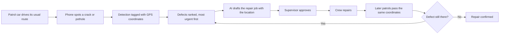

# Bird Eye V33

**Find road damage while it's still cheap to fix.**

## The problem

Township road maintenance is mostly reactive. The team learns about a defect
when a resident complains, sends a crew, and closes the ticket. Three things
are missing from that routine:

- **Early warning.** Roads usually fail slowly. A crack lets water in and
  becomes a pothole months later. Sealing the crack is a small job; repairing
  the pothole is not. Residents report potholes, not cracks, so the cheap
  stage is missed.
- **A full picture.** The team only knows about roads someone complained
  about. It cannot plan repairs or budget for roads it has never checked.
- **Proof that repairs held.** Once a ticket is closed, nobody goes back to
  check. A failed repair is found only when the next complaint arrives.

Inspecting every road by hand would fix this, but it takes staff time, and
every new township phase adds more roads.

## What Bird Eye does

A phone in each patrol car spots cracks and potholes while the car drives its
usual route. No one stops or files a report.

Every detection carries GPS coordinates. The app estimates where the defect
sits on the road ahead of the car, and each later sighting refines that
position, so the location gets more accurate with every pass.

Every defect reaches the maintenance team with its exact coordinates, ranked
so the most urgent are handled first. Each record shows a photo of the defect,
when it was first seen and how many times. An AI agent drafts the repair job
with the location attached, and a supervisor approves it. After the repair,
later patrols drive past the same coordinates. If the defect is gone, the
repair is confirmed. If it returns, the record reopens with its history.

Residents don't use Bird Eye. They benefit from roads that are repaired
earlier and repaired properly.



Detail: [docs/architecture.md](docs/architecture.md).

## What we claim and what we do not

- The model has 2 classes only: pothole and crack.
- It is trained on RDD2022 only, a public road damage dataset with no Malaysian roads.
- We claim no accuracy for Malaysian roads. Reason: the model has not been tested on them. Measuring it is the first task of a pilot.
- Drains, street lights, fallen trees and illegal dumping are not detected. They are future work.

## Repo map

| Folder | What it is |
|---|---|
| [`eagle/`](eagle/CLAUDE.md) | Android app that detects defects on the phone (Kotlin, Jetpack Compose) |
| [`backend/`](backend/CLAUDE.md) | API, background jobs and agents (Python, FastAPI, uv) |
| [`dashboard/`](dashboard/CLAUDE.md) | Staff web dashboard (Next.js, shadcn/ui; Leaflet planned, not installed) |
| [`ml/`](ml/CLAUDE.md) | Model training and conversion to LiteRT (Python, PyTorch, uv) |
| [`docs/`](docs/decisions.md) | Architecture, API contract, decisions and licence register |

## Getting started

You only need the tools for the part you work on. Each folder is a separate project, so every command below runs inside its own folder.

How to read the command boxes: type each line into a terminal and press Enter. Anything after a `#` is a note for you, not part of the command, so leave it out. For example, for `npm run dev   # open http://localhost:3000`, type only `npm run dev`.

### 1. Get the code

```bash
git clone https://github.com/lloonnn/BirdEyeV33.git
cd BirdEyeV33
```

### 2. Dashboard (web)

Install Node.js 20.9 or later from [nodejs.org](https://nodejs.org) (the LTS version is fine). npm comes with it. Next.js 16.4 needs at least 20.9.

Before the first run, copy the settings template and add the map key:

```bash
cd dashboard
cp .env.example .env.local    # then paste the CARTO key after NEXT_PUBLIC_CARTO_KEY=
```

Get a free key at [carto.com/basemaps/apikey](https://carto.com/basemaps/apikey), or ask the team for the shared one. Without it the map shows an "API key required" watermark. `.env.local` is ignored by git, so the key is never committed.

```bash
npm install        # first time, and again whenever package.json changes
npm run dev        # open http://localhost:3000
```

`npm run dev` is all you need while working. It reloads the page as you edit. Run these two before you push, because the build fails on errors that dev mode lets through:

```bash
npm run lint       # checks code style and common mistakes
npm run build      # checks that the production build compiles
```

### 3. eagle (Android app)

Install [Android Studio](https://developer.android.com/studio). It includes the JDK and the Android SDK, so nothing else is needed. Use a version that supports Android Gradle plugin 9.4.1.

1. In Android Studio, choose **Open** and select the `eagle` folder, not the repo root. Reason: `eagle/` holds the Gradle project.
2. Wait for the Gradle sync to finish. The first sync downloads Gradle 9.6.0 and can take several minutes.
3. Connect a phone with USB debugging on, or start an emulator, then press **Run**.

You can also build from a terminal. This is optional; the **Run** button does the same thing.

`gradlew` is a script inside the `eagle` folder, so the terminal must be in that folder. The easiest way: in Android Studio, open the **Terminal** tab at the bottom of the window. It opens in the `eagle` folder already. Then type one of these and press Enter:

```bash
./gradlew assembleDebug          # build the app file (APK)
./gradlew installDebug           # install it on a connected phone or emulator
./gradlew testDebugUnitTest      # run the unit tests (template examples only)
```

On Windows, type `.\gradlew` instead of `./gradlew`, for example `.\gradlew assembleDebug`. Reason: the Windows terminal in Android Studio is PowerShell, which needs the `.\` prefix.

From any other terminal, go into the folder first with `cd eagle` from the repo root. That terminal also needs a JDK: if it says `java` is not found, use Android Studio's Terminal tab instead.

### 4. backend and ml (Python)

The backend and ml projects are written in Python. To run them you need a tool called [uv](https://docs.astral.sh/uv/). uv downloads the right Python version and every package the project needs, so you install only uv yourself.

If you already have Python, install uv with pip:

```bash
pip install uv
```

On recent Ubuntu or Debian, use `pipx install uv` instead. Reason: the system blocks global `pip` installs to protect its own Python.

If you do not have Python, use the install script. It needs no Python:

```bash
# macOS and Linux
curl -LsSf https://astral.sh/uv/install.sh | sh
```

```powershell
# Windows (PowerShell)
powershell -ExecutionPolicy ByPass -c "irm https://astral.sh/uv/install.ps1 | iex"
```

Open a new terminal so `uv` is on your path, then check it with `uv --version`. Use uv 0.12 or later. Whichever way you installed uv, it downloads Python 3.14 for the projects, so your own Python version does not matter.

```bash
cd backend       # or: cd ml
uv sync          # creates .venv and installs dependencies
uv run backend   # in ml/: uv run ml
```

## Documentation

- [docs/architecture.md](docs/architecture.md): how the system works, end to end.
- [docs/api-contract.md](docs/api-contract.md): endpoints and payloads between the phone, backend and dashboard.
- [docs/decisions.md](docs/decisions.md): scope, decision log and licence register. It overrides every other document.
- [CONTRIBUTING.md](CONTRIBUTING.md): branches, commits, reviews and owners.

## Questions

Common questions and answers: [docs/faq.md](docs/faq.md).

