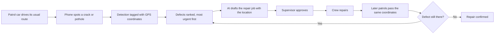

# Bird Eye V33

**Find road damage while it's still cheap to fix.**

## The problem

Township road maintenance is mostly reactive. The team learns about a defect
when a resident complains, sends a crew, and closes the ticket. Three things
are missing from that routine:

- **Early warning.** Roads usually fail slowly. A crack lets water in and
  becomes a pothole months later. Sealing the crack is a small job; repairing
  the pothole is not. Residents report potholes, not cracks, so the cheap
  stage is missed.
- **A full picture.** The team only knows about roads someone complained
  about. It cannot plan repairs or budget for roads it has never checked.
- **Proof that repairs held.** Once a ticket is closed, nobody goes back to
  check. A failed repair is found only when the next complaint arrives.

Inspecting every road by hand would fix this, but it takes staff time, and
every new township phase adds more roads.

## What Bird Eye does

A phone in each patrol car spots cracks and potholes while the car drives its
usual route. No one stops or files a report.

Every detection carries GPS coordinates. The app estimates where the defect
sits on the road ahead of the car, and each later sighting refines that
position, so the location gets more accurate with every pass.

Every defect reaches the maintenance team with its exact coordinates, ranked
so the most urgent are handled first. Each record shows a photo of the defect,
when it was first seen and how many times. An AI agent drafts the repair job
with the location attached, and a supervisor approves it. After the repair,
later patrols drive past the same coordinates. If the defect is gone, the
repair is confirmed. If it returns, the record reopens with its history.

Residents don't use Bird Eye. They benefit from roads that are repaired
earlier and repaired properly.



Detail: [docs/architecture.md](docs/architecture.md).

## Features

- On-phone detection of cracks and potholes.
- GPS location of the defect ahead of the car.
- Repeat sightings merge into one defect.
- Urgency ranking: high, medium or low.
- Supervisor review of uncertain detections.
- AI-drafted work orders and a daily brief.
- Defect lifecycle from detected to confirmed, with reopen.
- Replay mode for demos without driving.

## Tech stack

| Part | Built with |
|---|---|
| Android app | Kotlin 2.2.10, Jetpack Compose, CameraX, Room, WorkManager, OkHttp |
| Model | LiteRT, 2 classes (pothole and crack), bundled in the app |
| Backend | Python 3.14, FastAPI, SQLAlchemy, Alembic, uvicorn |
| Database | PostgreSQL 17 with PostGIS 3.5 |
| Dashboard | Next.js 16.4, React 19, TypeScript, Tailwind CSS 4, shadcn/ui, Leaflet, Recharts |
| AI | Gemini, through the `google-genai` package |
| Run | Docker Compose, or uv and npm |

## What we claim and what we do not

- The model has 2 classes only: pothole and crack.
- Trained on RDD2022, a public road damage dataset ([doi.org/10.6084/m9.figshare.21431547](https://doi.org/10.6084/m9.figshare.21431547)). No Malaysian roads.
- We claim no accuracy for Malaysian roads. Reason: the model has not been tested on them. Measuring it is the first task of a pilot.
- Drains, street lights, fallen trees and illegal dumping are not detected. They are future work.
- Repair confirmation is built, but clean passes are recorded only through a dev endpoint today.
- Face and plate blur is not built. Crops can show faces and plates.

## Future Improvement
- Retrained model with the reviewed detection come from human feedback to improve accuracy in from the Malaysian roads.
- Apply face and plate blur on the crop images.
- Allow more detection classes such as street lights, drains, etc.
- Upgrade to AI dashcam 

## Repo map

| Folder | What it is |
|---|---|
| [`eagle/`](eagle/) | Android app that detects defects on the phone (Kotlin, Jetpack Compose) |
| [`backend/`](backend/) | API and agents (Python, FastAPI, uv) |
| [`dashboard/`](dashboard/) | Staff web dashboard (Next.js, shadcn/ui, Leaflet) |
| [`ml/`](ml/) | Model training and conversion to LiteRT (Python, PyTorch, uv) |
| [`docs/`](docs/) | Architecture, API contract, user guide and FAQ |

## Quick start

You need only [Docker](https://docs.docker.com/get-docker/).

```bash
cd backend
cp .env.example .env     # optional, only for API keys
docker compose up --build
```

Open http://localhost:3000. Ctrl+C stops it. Add `-d` to get the terminal back, then use `docker compose logs -f`.

Full steps, phone app and manual route: [SETUP.md](SETUP.md).

## Documentation

- [SETUP.md](SETUP.md): how to run it.
- [docs/architecture.md](docs/architecture.md): how the system works, end to end.
- [docs/api-contract.md](docs/api-contract.md): endpoints and payloads between the phone, backend and dashboard.
- [docs/user-guide.md](docs/user-guide.md): how staff use the dashboard.
- [docs/faq.md](docs/faq.md): common questions and answers.

## Source

- crack-1.jpg : https://www.pexels.com/photo/cars-by-the-road-14677883/
- pothole-1.jpg: https://www.pexels.com/photo/scenic-country-path-with-reflective-puddle-37733541/
- pothole-2.jpg: https://www.pexels.com/photo/narrow-street-with-puddles-17158119/

- Project demo: https://youtu.be/L4j-fjju8hE
- Project set up (Complement of [SETUP.md](SETUP.md)): https://youtu.be/wMD4u-bM8u0