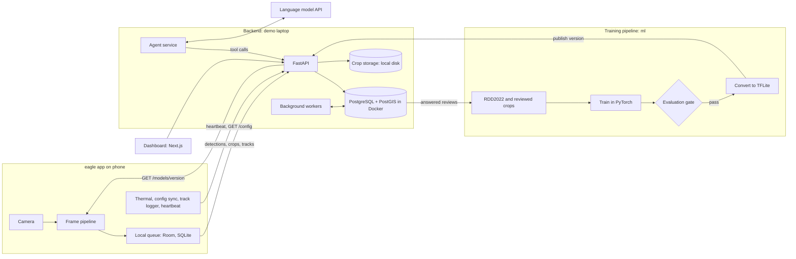
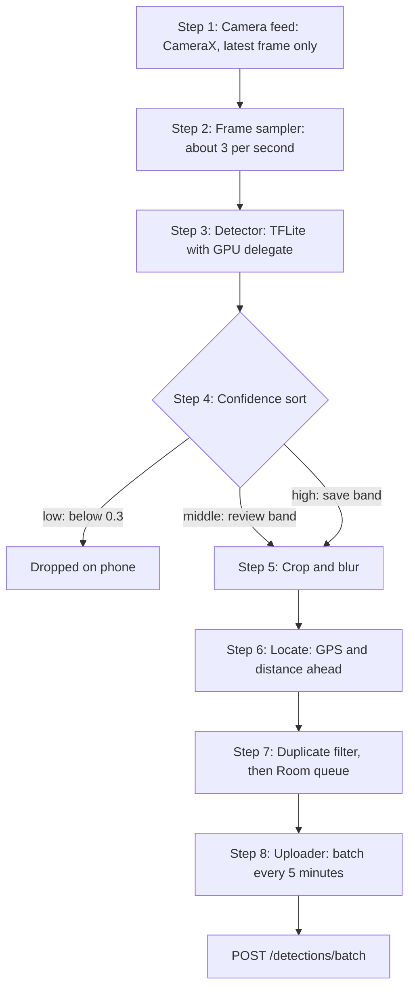
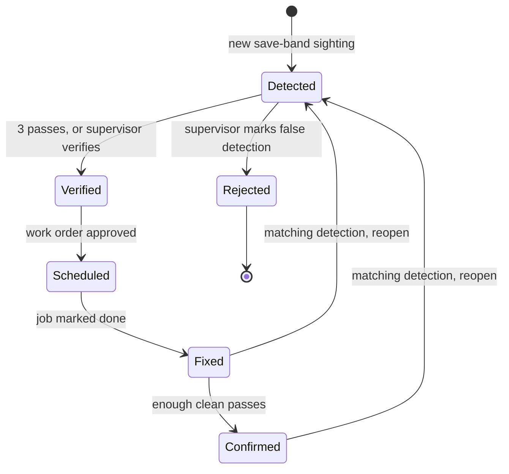
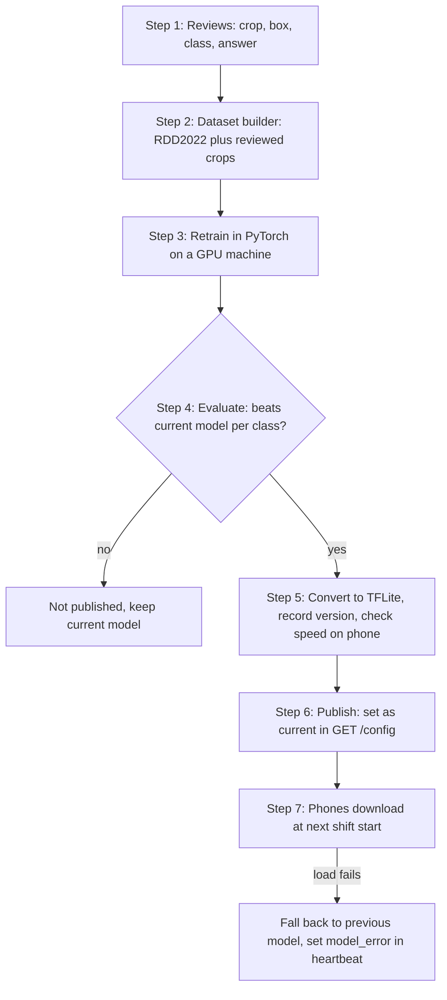

# Bird Eye v33 Architecture

Sources: `docs/reference/architecture-source.md` (main) and `docs/reference/proposal-source.md` (product context). [decisions.md](decisions.md) wins over both sources and over this file, because it records the current team decisions. Every number marked "starting value, to be tuned" is untested.

## 1. Overview

Bird Eye v33 turns the vehicles that already patrol a township into a daily road inspection network. A dedicated Android phone in each car or van runs a small object detector on camera frames and finds potholes and cracks. Only small records with a blurred crop, a location and a time leave the phone. A backend merges repeated sightings into one defect, ranks defects by urgency and confirms repairs from later passes that actually saw the spot. A dashboard shows staff the map, the review queue, agent-drafted work orders, coverage and device status.

**Pilot scope:** cars and vans only, one precinct of City of Elmina, no resident-facing screens. Reason: phones are unreliable on motorcycles in Malaysian heat and vibration.

| Component | Folder | Runs on | Owns |
|---|---|---|---|
| eagle app | `eagle/` (package `com.birdeye`) | Dedicated Android phone in each vehicle; Kotlin, Jetpack Compose, CameraX | Camera capture, on-device detection, blurring, local queue, upload, heat handling |
| Backend API | `backend/` (FastAPI, uv) | The demo laptop | Ingest of records and tracks, model distribution, dashboard data |
| Database and storage | n/a | PostgreSQL with PostGIS in Docker; crops on local disk behind a storage interface | Defects, sightings, GPS tracks, coverage, work orders, reviews, model versions |
| Background workers | `backend/` | Same server, scheduled jobs run by APScheduler | Merging sightings into defects, urgency ranking, coverage gaps, repair confirmation |
| Agent service | `backend/`, package `bird_eye.agents` | Same server, calls a language model API | Drafting work orders and the daily brief; drafts wait for approval |
| Dashboard | `dashboard/` | Browser; Next.js, shadcn/ui Vega style, Bklit charts, Leaflet | Live map, review queue, work order approval, device status, coverage view |
| Training pipeline | `ml/` (separate uv project) | Developer machine or cloud GPU, on demand | Training, evaluation, conversion to TensorFlow Lite (LiteRT), publishing |

Design choices:
- Clients talk only to the backend API, never to the database. Reason: one place validates and controls all writes.
- The database is the single source of truth for every worker, agent and screen. Reason: no component holds its own copy of defect state.
- Detection runs on the phone. Reason: only kilobyte records cross the network, and video never leaves the device.
- `backend/` and `ml/` are separate uv projects. Reason: the server never installs PyTorch.
- The demo runs on a laptop, with PostgreSQL and PostGIS in Docker and crops on local disk behind a storage interface. Reason: the demo needs no cloud account or network, and the storage interface lets object storage replace local disk later without changing callers.

## 2. System diagram

## 3. eagle app internals

The app's core is a frame pipeline. Each camera frame either dies early or becomes a small record in a local queue. Four background services run beside it. Video is never stored or uploaded: each sampled frame is analysed in memory and discarded within a fraction of a second.

### Frame pipeline

1. **Camera feed.** CameraX `ImageAnalysis` with the keep-only-latest strategy. Reason: a slow step never builds a backlog.
2. **Frame sampler.** Passes about 3 frames a second (starting value, to be tuned). Reason: at 40 km/h the vehicle moves about 3.7 m between frames and a defect is visible over about 10 m, so each defect appears in 2 to 3 frames. 1 frame a second can miss a defect; 10 makes the phone work harder and heat up with no real gain. The rate can follow GPS speed, about 2 on slow streets and 4 to 5 on faster roads (starting values, to be tuned). Sampling stops when the vehicle has been parked for a while.
3. **Detector.** A small object detector (licence to confirm, e.g. YOLOX, Apache 2.0) converted to TensorFlow Lite (LiteRT) and run with the GPU delegate where the phone supports it. Output per detection: box, class (`pothole` or `crack`) and confidence. Reason: the GPU delegate keeps inference fast enough on a phone. Benchmark speed on the target phone in week one.
4. **Confidence sort.** High confidence becomes a save record, the middle band becomes a review record, low confidence is dropped. Thresholds come from config, not code. Reason: thresholds can change without an app release.
5. **Crop and blur.** Only the defect box plus a margin is cropped and compressed as JPEG. A light face and plate detector runs on the crop and blurs anything it finds before the crop is stored. Reason: no personal data reaches the server.
6. **Locate.** Attaches GPS position, accuracy, heading and speed, and estimates the defect's distance ahead (formula below).
7. **Duplicate filter and local queue.** If a defect of the same class was recorded within 5 m in the last 5 s (starting values, to be tuned), the app keeps only the highest-confidence record. Reason: one pothole becomes one record per pass. Records are written to SQLite through Room. Reason: a crash or reboot loses nothing.
8. **Uploader.** A WorkManager job uploads the queue in batches every 5 minutes during the shift over mobile data (starting value, to be tuned), retrying with backoff. Reason: records are kilobytes and the dashboard is live, so waiting for WiFi at end of shift gains nothing. The record's `urgent` flag is always false in the 2-class version. Reason: no pothole or crack needs to jump the batch; the flag is kept for future classes.

### Background services

- **Thermal manager.** Reads Android's thermal status and battery temperature. As heat rises it lowers the frame rate (state `cooling`), then pauses the pipeline (state `paused`, reason `heat`), then resumes when the phone cools. Every pause is logged. Reason: the backend must know which roads were not scanned, and the driver cannot fix a hot phone mid-route.
- **Config sync.** At shift start, calls `GET /config` for the current model version and thresholds, and downloads a new model with `GET /models/{version}` only if the version changed. It keeps the last good copy for offline use. The model bundled in the app is only the offline fallback. Reason: models update without an app release.
- **Track logger.** Records a GPS point every second while scanning (starting value, to be tuned), simplifies the line and uploads it with the batch, together with the time ranges when scanning was active. Each active range carries its frame rate. Reason: the backend turns tracks into coverage, and it needs the frame rate to count frames per segment.
- **Heartbeat.** Posts device status every 60 seconds (starting value, to be tuned): state, pause reason, online flag, queue size, temperature, app and model version, and any model load error. Reason: the dashboard needs live device state, and the model error shows a phone stuck on an old model.
  - `scanning`: active, full frame rate.
  - `cooling`: active, reduced frame rate.
  - `paused`: not active. `pause_reason` is `heat` or `parked`.
  - `online` is a boolean, separate from `state`. Reason: a phone can scan while offline and upload later.

"Shift start" here means the app's Start shift screen. There are no shift records on the server in this build.

**Running all shift.** The pipeline runs in an Android foreground service with a persistent notification, started from the Start shift screen. Inference runs on its own background thread; the UI thread only shows status. Check the current Android rules for camera use in foreground services on the target Android version.

### Distance ahead

The phone sits at a known height and downward tilt, set during the mount check. The row of the box's bottom edge gives the angle below the horizon, and flat-road geometry gives the distance:

$$
d = \frac{h}{\tan(\alpha + \beta)}
$$

where $h$ is the camera height, $\alpha$ the camera's downward tilt and $\beta$ the angle of the box's bottom edge below the image centre. The defect point is then offset by $d$ along the vehicle heading $\theta$:

$$
\text{defect position} = \text{vehicle position} + d \cdot (\sin\theta,\ \cos\theta)
$$

This assumes a flat road. Treat it as an estimate that averaging many sightings improves.

### Starting parameters

All of these come from config and are starting values, to be tuned during the heat test and testing.

| Parameter | Starting value |
|---|---|
| Sampled frame rate | about 3 per second |
| Model input size | 640 px, drop to 320 px if too slow or hot |
| Confidence bands | above 0.8 save, 0.3 to 0.8 review, below 0.3 drop |
| Crop | defect box plus margin, JPEG, longest side about 640 px |
| GPS interval | 1 second while scanning |
| Heartbeat | every 60 seconds |
| Upload batch | every 5 minutes |
| Duplicate filter | same class within 5 m and 5 s |

## 4. Data contracts

Full contract with JSON examples: [api-contract.md](api-contract.md). All traffic is JSON over HTTPS, except crop images, which upload as multipart files.

| Method and path | Caller | Purpose |
|---|---|---|
| `GET /config` | Phone | Current model version and thresholds |
| `GET /models/{version}` | Phone | Download the TFLite model file |
| `POST /detections/batch` | Phone | Upload a batch of detection records with their crops |
| `POST /tracks` | Phone | Upload a simplified GPS trace with active scanning ranges |
| `POST /heartbeat` | Phone | Device status every 60 seconds |
| `GET /defects` | Dashboard | Defects in a map area, filtered by type, status, urgency |
| `GET /reviews` and `POST /reviews/{id}` | Dashboard | Unsure detections to label, and the supervisor's answer |
| `POST /defects/{id}/verify` and `POST /defects/{id}/reject` | Dashboard | Supervisor verifies a defect, or rejects it as a false detection |
| `GET /work-orders` and `POST /work-orders/{id}/approve` | Dashboard | Agent-drafted jobs waiting for approval |
| `PATCH /work-orders/{id}` and `POST /work-orders/{id}/reject` | Dashboard | Edit a drafted job, or reject it |
| `POST /work-orders/{id}/done` | Dashboard | Mark a job done, which moves its defects to Fixed |
| `GET /brief/latest` | Dashboard | The latest daily brief |
| `GET /devices` and `GET /coverage` | Dashboard | Live device status, and scanned versus missed road segments |

## 5. Backend processing

The backend turns many noisy sightings into a small set of tracked defects, each with a status, an urgency and a history.

### Tables

| Table | Holds |
|---|---|
| `sightings` | Every uploaded detection record, raw, with its crop reference and nearest road segment ID |
| `defects` | One row per real-world defect: type, location, status, urgency, first and last seen |
| `reviews` | Unsure detections waiting for a supervisor, and the answer |
| `tracks` | Simplified GPS lines per device and time, with active scanning ranges |
| `road_segments` | The pilot precinct's roads split into short segments, with OSM highway class and last scanned time |
| `work_orders` | Agent-drafted and approved repair jobs, linked to defects |
| `models`, `devices` | Model versions, and a simple list of phone names and their vehicles |

Every sighting stores its `model_version`. Reason: accuracy can be compared across versions, and a bad model is rolled back by publishing the previous version.

### Ingest

`POST /detections/batch` validates each record, ignores any `client_id` already stored, saves the crop through the storage interface and inserts into `sightings` with the nearest road segment ID. Review-band records also go into `reviews`. Reason for `client_id`: it is made on the phone, so a retried upload is never stored twice.

Pins are not snapped to the road. The nearest segment ID is stored for coverage only, and the pin keeps its estimated position. Reason: snapping can move a pin onto the wrong road at a junction.

### Merge

For each new save-band sighting, look for an open defect of the same type within about 8 m (starting value, to be tuned), using PostGIS `ST_DWithin`.
- If found: attach the sighting, update last seen, and set the defect position to the average of its sightings. Reason: the average of many GPS readings is more precise than any one.
- If not found: create a new defect in Detected.

A nightly clean-up job can re-cluster with `ST_ClusterDBSCAN` to merge defects that drifted apart.

### Defect lifecycle

- **Detected to Verified:** automatically after sightings on 3 distinct passes (starting value, to be tuned), or immediately when a supervisor calls `POST /defects/{id}/verify`. Reason: a single bad record cannot create a verified defect.
- **Detected to Rejected:** a supervisor marks it as a false detection with `POST /defects/{id}/reject`. Its crop becomes a negative training example.
- **Verified to Scheduled:** a work order covering it is approved.
- **Scheduled to Fixed:** the supervisor marks the job done with `POST /work-orders/{id}/done`.
- **Fixed to Confirmed:** after about 3 clean passes (starting value, to be tuned) with no matching detection, falling on at least 2 different days. Reason: coverage, not time, decides this, so a road nobody drove cannot confirm a fix.
- **Back to Detected:** a matching detection near a Fixed or Confirmed defect reopens it, with the history kept.

**Pass.** A pass is one device's continuous active traversal of a segment. Two passes by the same device count separately only if they are at least 1 hour apart (starting value, to be tuned). Reason: a car circling one block must not pile up passes within minutes.

**Seen.** A segment is seen on a pass when it got at least 6 frames (starting value, to be tuned). The backend estimates frames from the track, because the phone does not send per-frame data:

$$
n = \sum_{r} t_r \cdot f_r \ge 6
$$

where $t_r$ is the number of active seconds in range $r$ during which the vehicle was within 10 m of the segment, and $f_r$ is that range's frame rate. Active means state `scanning` or `cooling`. A `paused` phone, for heat or parked, adds nothing. Reason: cooling lowers the frame rate, so the formula needs more seconds to count the same segment as seen, and a pause counts as zero.

**Clean pass versus not seen.** A later pass counts as a **clean pass** only if the defect's 50 m segment was seen on that pass and no matching defect was detected. A pass where the segment was not seen is **not seen**, never clean, and does not count toward Confirmed.

What the rule catches. It catches passes where the phone could not have seen the spot: scanning paused for heat, a parked phone that stopped sampling, and roads that were never driven. Without it, these gaps would look like clean road and confirm repairs that nobody checked.

What the rule does not catch. It does not detect occlusion. A phone passing a parked car that hides a pothole still gets enough frames, is active and is not paused. So it logs a clean pass, even though the pothole was never visible.

Mitigation. The clean passes must fall on at least 2 different days. A parked car rarely sits in the same spot across days, so a hidden pothole is likely to be visible on one of them. This reduces the occlusion risk but does not remove it, because a car parked in the same place every day can still hide a defect.

### Coverage

Road segments for the pilot precinct are loaded once from OpenStreetMap by a developer and split into segments of about 50 m (starting value, to be tuned). A segment counts as scanned on a pass when the seen rule above holds. Coverage and repair confirmation use the same "seen" rule. Reason: the coverage map and repair confirmation never disagree about whether a spot was seen.

The backend uses only the active scanning ranges of a track, so road driven while the phone was paused counts as missed. The dashboard shows segments not scanned within their target interval: daily for main roads and school routes, weekly for quiet streets (starting values, to be tuned). Main roads are OSM `highway` primary, secondary and tertiary. School routes are segments within 300 m of an OSM school (starting value, to be tuned). Reason: both come from the same OSM load as the segments, so no extra data source is needed. Detections that match no pilot road segment can be filtered out on the server. This is a segment list, not a township boundary setting.

### Urgency score

A simple, explainable weighted score ranks the repair list:

$$
\text{urgency} = w_t \cdot \text{type} + w_s \cdot \text{size} + w_l \cdot \text{location} + w_a \cdot \text{age}
$$

Each term is scaled from 0 to 1:
- **type:** a pothole scores higher than a crack (starting value, set with SDP). Reason: a pothole is the more immediate hazard to vehicles and motorcyclists;
- **size:** from the box area;
- **location:** on a school route, a main road or near a junction, using OSM. A junction is a segment within 30 m of an OSM node shared by 3 or more ways (starting value, to be tuned). Reason: junctions mix turning traffic, so a defect there is hit more often;
- **age:** time since first seen.

Start with equal weights (starting value, to be tuned), then set them with SDP's maintenance team. Reason: a visible formula, not a model, lets supervisors see why something is at the top.

### Jobs and schedule

| Job | When |
|---|---|
| Ingest | On each upload |
| Merge | Right after ingest |
| Urgency | Every hour |
| Coverage and repair confirmation | After each track upload, and nightly |
| Re-cluster with `ST_ClusterDBSCAN` | Nightly |
| Agent runs | Work order agent hourly; daily brief at 07:00 Malaysia time |

APScheduler runs every scheduled job inside the backend process. Reason: the pilot runs on one server, so a separate job queue adds parts without adding value.

## 6. Agent service

The agents turn defects into admin work: drafted jobs and briefs. They live in the backend package `bird_eye.agents`. Reason: they call the same backend functions as the API, so a separate service adds nothing. They read and write only through tools that call the backend, and every output that leaves the system waits for a human.

| Agent | Trigger | Output | Approval |
|---|---|---|---|
| Work order agent | New verified defects, checked every hour (starting value, to be tuned) | Draft work orders: description, crew type, grouped nearby defects | Supervisor approves, edits or rejects on the dashboard |
| Daily brief agent | 07:00 Malaysia time (starting value, to be tuned) | Summary of new, overdue and confirmed defects, and coverage gaps | None; read-only |

The escalation agent from the source is not built in this version. Reason: it needs data on which roads were handed to the council, which the pilot does not have (see Future work).

### Tools

| Tool | Does |
|---|---|
| `get_defects(area, status, since)` | Returns defects with type, location, urgency, sightings and crop links |
| `get_coverage(area, since)` | Returns scanned and missed road segments |
| `group_nearby(defect_ids, radius_m)` | Groups defects into one trip by distance |
| `create_work_order_draft(defect_ids, crew_type, description)` | Saves a draft with status `pending_approval` |
| `post_brief(text)` | Publishes the daily brief to the dashboard |

### How a run works

A scheduled job starts the agent with its goal and tool list. The agent calls the language model API with tool calling. The backend executes each tool call and returns the result. The loop ends when the agent saves its draft or reaches a step limit. Implement it as a small state machine in Python, or with a framework such as LangGraph.

### Guardrails

These are enforced in code, not only in the prompt.
- Agents have no tool that sends anything outside the system or changes a defect's status. Only approved drafts are acted on. Reason: no agent output reaches crews without a supervisor.
- Every number, date and location in a draft must come from a tool result. Drafts store the defect IDs they cite. Reason: a reviewer can check each claim.
- Every agent run is logged with its tool calls and outputs.
- If the language model API is down, defects and maps still work; only drafts are delayed.

## 7. Dashboard

Built with Next.js, shadcn/ui (Vega style) for layout and components, Bklit charts installed through the shadcn registry, and plain Leaflet wrapped in one React component for the map. Reason: react-leaflet is Hippocratic-2.1, which is not an OSI licence and may conflict with SDP's commercial use. Dark by default, with a light theme from the same tokens. No login in this build, and no resident page.

| Page | For | Shows and does | Reads from API |
|---|---|---|---|
| Overview (live map) | Supervisor | Full-screen map with defect pins by type and urgency, crops, sighting history, status; floating panels for the brief, stats, selected defect and fix-first list | `GET /defects` for the visible area only; `POST /defects/{id}/verify`, `POST /defects/{id}/reject` |
| Review | Supervisor | Unsure detections; one-click yes or no; answers become labels | `GET /reviews`, `POST /reviews/{id}` |
| Work orders | Supervisor | Agent drafts to approve, edit or reject; job status through to Fixed | `GET /work-orders`, `POST /work-orders/{id}/approve`, `PATCH /work-orders/{id}`, `POST /work-orders/{id}/reject`, `POST /work-orders/{id}/done` |
| Coverage | Supervisor | Scanned versus missed road segments by target interval | `GET /coverage` |
| Devices | Supervisor | Each phone's live state from heartbeats: scanning, cooling, paused with its reason, online or offline, unreachable | `GET /devices` |
| Daily brief | Manager | The morning summary from the brief agent | `GET /brief/latest` |

Design choices:
- The map reads `GET /defects` for the visible area only. Reason: it stays fast as the township grows.
- The map component loads with `ssr: false`, and its container gets `isolation: isolate`. Reason: Leaflet needs the browser, and dialogs must stay above the map.
- Marker clustering needs a plugin whose licence is still to verify. Reason: every map dependency needs a licence register row first.
- Only the Overview's floating panels use glass, through one shared `.panel` class with a `.no-glass` fallback. Reason: blur is recomputed while the map pans, so it is kept small and can be switched off in one place.
- Status colour is always paired with a word or icon. Reason: colour alone is not readable for everyone.

The app and the dashboard share one set of theme tokens. The source of truth is `dashboard/app/globals.css` for the dashboard and `BirdEyeTheme()` in `eagle/app/src/main/java/com/birdeye/ui/theme/BirdEyeTheme.kt` for the app. Reason: the running code is what users see, so the reference source is not the authority for token values. A change to a token goes into both files in the same commit, so the two products never drift apart.

## 8. Training and model updates

The first model has 2 classes, pothole and crack, and is trained on RDD2022 only. There is no local Malaysian data yet. Reason for 2 classes: the maintenance team needs fix-first decisions, not crack types. Training uses PyTorch, and the model is converted once to TensorFlow Lite (LiteRT) to run on the phone with the GPU delegate.

The detector is a small object detector (licence to confirm, e.g. YOLOX, Apache 2.0). Reason: Ultralytics YOLO is AGPL-3.0, which may conflict with the hackathon IP terms.

After the first model, labels come from normal use during the pilot: every supervisor answer in the review queue, and every approval or rejection of a detection.

1. **Reviews.** Each answered review stores the crop, the box, the class and the answer: correct, wrong class, or not a defect.
2. **Dataset builder.** Combines RDD2022 with reviewed local crops, once they exist. Keeps a fixed held-out set of local examples that is never trained on. Reason: every model is measured against the same test.
3. **Retrain.** Fine-tunes the detector on a GPU machine, on demand, for example once a few hundred new labels have built up.
4. **Evaluate.** Compares the new model with the current one on the held-out set, using mAP@0.5 per class (starting value).
5. **Export.** Converts to TensorFlow Lite, records a version ID, and checks speed on the target phone.
6. **Publish.** Sets the version as current in `GET /config`.
7. **Phones update.** At the next shift start, config sync downloads the new model. A phone that fails to load it falls back to the previous model and reports the error in the heartbeat's `model_error` field. The model bundled in the app is only the offline fallback.

### Evaluation gate

**If a new model does not beat the current model's mAP@0.5 on the held-out set, per class, it is not published.** It must also run at the required speed on the target phone; the goal is 3 frames a second on the cheapest team phone (starting value, to be tuned).

The first model has no current model to beat and no local held-out set. Its mAP@0.5 per class is reported on RDD2022's own test split, and no accuracy is claimed for Malaysian roads. If the RDD2022 test labels are not public, a fixed slice of the training data is held out instead and never trained on. Reason: every model must be measured against the same test. Reason: RDD2022 has no Malaysian images, so local accuracy will probably be lower.

**Known limitation.** The loop only learns from defects the model already notices, at least faintly. Defects it misses completely never reach a supervisor. A later "add missed defect" button closes this gap (Future work).

## 9. Security and privacy

**There is no authentication in the hackathon build.** The server accepts uploads from any client, and the dashboard has no login.

Security:
- Run the demo on a laptop, and use test data where possible. Reason: anyone who can reach the API can read and write.
- In the demo only, the phone talks to the laptop over plain HTTP on local Wi-Fi. An Android network security config allows cleartext for the laptop's address only. Reason: a laptop on local Wi-Fi has no trusted certificate, and limiting cleartext to one address keeps every other connection on HTTPS.
- Any server off the laptop uses HTTPS.
- Language model API keys stay on the server; no client calls the model directly.

Privacy:
- Video never leaves the phone. Frames are analysed in memory and discarded.
- Only defect crops are stored, with faces and number plates blurred on the phone before saving.
- GPS tracks come only from township vehicles on duty.
- No driver performance metrics are computed from tracks or heartbeats. This rule is written into the project.
- Retention periods for crops and tracks, and data ownership, are agreed with SDP and follow Malaysia's personal data protection law.

## 10. Build order and demo plan

### Build order

1. Detector on recorded footage on a laptop: get the model finding potholes and cracks in locally recorded video.
2. Backend ingest, merge and the `defects` table, fed by the laptop pipeline.
3. Dashboard live map with crops and status.
4. eagle app running the same model on the phone, uploading to the backend.
5. Repair confirmation and the review queue.
6. Work order agent and daily brief.
7. Coverage and device status, if time allows.

The demo only needs steps 1 to 5 working end to end. The rest can be shown at smaller scale.

### Demo plan

The system does not depend on where it runs, so the team tests near campus and presents it as Elmina, with test-site footage labelled as such.

1. **Real potholes and cracks nearby.** Drive local roads and car parks with a mounted phone recording.
2. **Replay mode in the app.** The app reads a recorded video and a recorded or simulated GPS track instead of the live camera and GPS. The rest of the pipeline runs unchanged. Tracks can be mapped onto Elmina coordinates for the pitch.
3. **Scenario script.** A script feeds pre-made detections into the backend over a few minutes, as if a week of patrols happened. It shows merging, verification, a fix and confirmation in one demo.

| Demo scene | Source | Shows |
|---|---|---|
| Live boxes on potholes and cracks | Replay of a recorded local drive | On-phone detection |
| Pins appear on the map | Same replay, uploading | Locating and upload |
| Same pothole on 3 drives becomes one defect | Scenario script | Merging and tracking |
| Agent drafts a job, supervisor approves | Live on the dashboard | Agents with approval |
| Fixed pothole confirmed after clean passes | Scenario script | Repair confirmation |
| Small pothole outside a school ranked above a larger one on a quiet street | Live on the dashboard | The location term in the urgency score |

The recorded local footage is used for testing and the demo only, not for training. Measuring and improving accuracy on local roads happens in the pilot (see Open questions).

## 11. Future work

Not in the hackathon build:

- **More defect types:** drains, street lights (including night detection), fallen trees, illegal dumping. Later also faded road markings, overgrown verges, illegal signage, damaged footpaths, fallen fences. Drains need their own labelled images, because no public dataset labels drain defects.
- **Local Malaysian training data,** starting with the pilot's shadow run.
- **Authentication:** a secret key per phone sent with every upload, which can be switched off for a lost phone; dashboard logins with admin, supervisor and viewer roles; dedicated phones locked to the app.
- **Shift records:** explicit start and end shift records on the server. For now the server groups data by device and time, and the end-of-shift summary is calculated on the phone.
- **Township boundary setting:** an admin draws and versions the outline on the dashboard map, for example with Leaflet-Geoman; phones download it at shift start and skip frames outside it.
- **Resident page:** repair status near a resident's home inside SDP's existing app.
- **"Add missed defect" button,** so the model learns from defects it never detected.
- **Motorcycle coverage** with outdoor-rated cameras in record now, process later mode.
- **Escalation agent:** drafts council reports for roads already handed to the council. It needs handover data first.
- From the proposal: commercial AI dashcams, an edge computer with a fixed camera, more vehicle types, council data handover, a contractor quality view.

## 12. Open questions

Only open, verify and mentor items remain. Everything else is settled in [decisions.md](decisions.md). Track field names, response bodies and the error format are deferred there.

**Open: the team decides**
1. Which detector, after the licence check against the hackathon IP terms.
2. The tool path from PyTorch to LiteRT.
3. Which face and plate blur model runs on the crop.
4. Which language model the agents use.
5. What to do before the demo if the RDD2022 model misses most local potholes and cracks. Local labelling is ruled out for now; local testing happens in the pilot.

**Verify**
6. RDD2022 licence terms for this use.
7. Whether RDD2022 test labels are public. If not, hold out a fixed slice of the training data.
8. The licence of the Leaflet marker clustering plugin.
9. Every other row marked verify in the licence register in decisions.md.

**Mentors**
10. How SDP finds defects today and how long a typical repair takes: the baseline the pilot is measured against.
