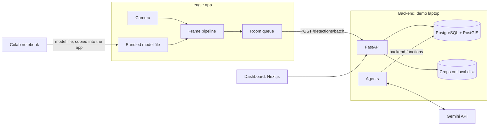
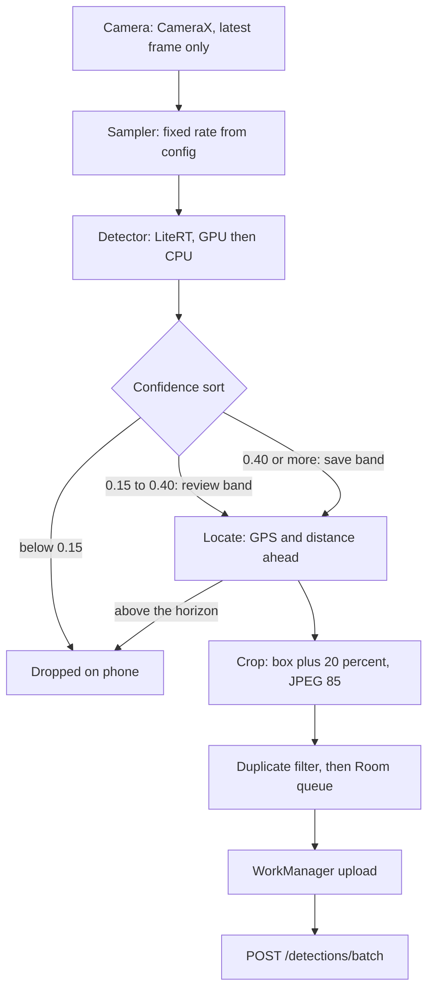
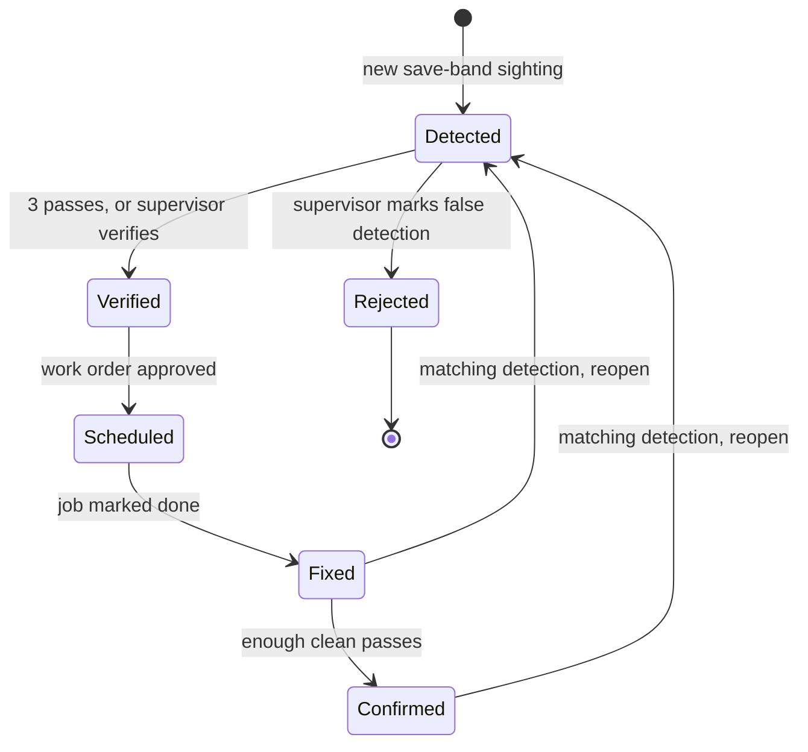

# Bird Eye v33 Architecture

Matches the code as of 600a4e9.

Every number marked "starting value, to be tuned" is untested.

## 1. Overview

Bird Eye v33 turns patrol vehicles into a road inspection network. A phone in each car runs a small detector on camera frames and finds potholes and cracks. Only small records with a crop, a location and a time leave the phone. The backend merges repeated sightings into one defect and ranks defects by urgency. A dashboard shows the map, the review queue and agent-drafted work orders.

| Part | Folder | What it is |
|---|---|---|
| eagle app | `eagle/` (package `com.birdeye`) | Android app: Kotlin, Jetpack Compose, CameraX, LiteRT, Room, WorkManager |
| Backend | `backend/` | FastAPI and uv. Ingest, merge inside ingest, urgency computed in SQL at read time, work orders, reviews |
| Database | n/a | PostgreSQL with PostGIS in Docker. Crops are files on local disk behind a storage interface |
| Agents | `backend/`, package `bird_eye.agents` | Work order agent and brief agent, run by command line or `/dev/agents/*`. They call the Gemini API |
| Dashboard | `dashboard/` | Next.js, shadcn/ui, Leaflet. Three pages |
| Training | `ml/` | A Colab notebook. Separate uv project from the backend |

Design choices:
- Clients talk only to the backend API, never to the database. Reason: one place validates all writes.
- Detection runs on the phone. Reason: only small records cross the network, and video never leaves the device.
- The demo runs on a laptop. Reason: it needs no cloud account.
- The storage interface lets object storage replace local disk later without changing callers.

## 2. System diagram

## 3. eagle app

The app has three screens: Start shift, Scanning and End of shift. Start shift checks GPS and the phone's mount tilt.

Each camera frame either dies early or becomes a record in a local queue. Video is never stored or uploaded. Each sampled frame is analysed in memory and discarded.

### Frame pipeline

1. **Camera.** CameraX `ImageAnalysis`, keep only the latest frame. Reason: a slow step never builds a backlog.
2. **Sampler.** Fixed rate from config, 3 frames a second. It does not use GPS speed.
3. **Detector.** A LiteRT model, run on the GPU, with a CPU fallback. Input is 640 px. Output per detection: box, class (`pothole` or `crack`) and confidence.
4. **Confidence sort.** Save band at 0.40 or more. Review band at 0.15 or more. Anything lower is dropped.
5. **Locate.** Adds GPS position, accuracy, heading and speed, and the distance ahead. A detection above the horizon is dropped.
6. **Crop.** The box plus a 20 percent margin, as JPEG at quality 85, long side at most 640 px.
7. **Duplicate filter and queue.** The same class within 5 m and 5 s keeps only the best record. Save and review bands are filtered separately. A record that was already uploaded is never replaced. Records go to SQLite through Room. Reason: a crash loses nothing.
8. **Upload.** WorkManager sends the queue to `POST /detections/batch`. A periodic job runs at the configured interval, with a 15 minute floor. A one-off job also runs shortly after each queued record. A batch holds up to 50 records. Only records older than the duplicate window are sent. A 422 resends the batch one record at a time.

All of these values are tunable config values and starting values: frame rate 3, input 640 px, bands 0.40 and 0.15, duplicate filter 5 m and 5 s.

Face and plate blur is not built. Crops can show faces and plates.

### Distance ahead

The phone sits at a known height and downward tilt. The row of the box's bottom edge gives the angle below the horizon:

$$
d = \frac{h}{\tan(\alpha + \beta)}
$$

Here $h$ is the camera height, $\alpha$ the camera's downward tilt and $\beta$ the angle of the box's bottom edge below the image centre. The defect point is the vehicle position moved by $d$ along the heading $\theta$:

$$
\text{defect position} = \text{vehicle position} + d \cdot (\sin\theta,\ \cos\theta)
$$

This assumes a flat road. Treat it as an estimate that averaging many sightings improves.

## 4. API

See [api-contract.md](api-contract.md).

## 5. Backend processing

### Tables

| Table | Holds |
|---|---|
| `sightings` | Every uploaded detection record, with its crop reference |
| `defects` | One row per real-world defect. `segment_id` is always null |
| `defect_history` | Every status a defect has had |
| `reviews` | Unsure detections waiting for a supervisor, and the answer |
| `clean_passes` | Passes that saw a fixed defect with no matching detection |
| `work_orders`, `work_order_defects` | Drafted and approved repair jobs, linked to defects |
| `agent_runs`, `agent_tool_calls` | Every agent run and its tool calls |
| `briefs`, `brief_defects` | Daily briefs and the defects each cites |

### Ingest

`POST /detections/batch` validates each record, ignores any `client_id` already stored, saves the crop through the storage interface, inserts the sighting, merges it and queues a review if one is needed. Records are handled in `captured_at` order.

Pins are not snapped to a road. They keep the estimated position.

### Merge

For each new save-band sighting, look for a defect of the same type within 8 m (`merge_radius_m`), nearest first, using PostGIS `ST_DWithin`.
- An open defect (Detected, Verified or Scheduled) gets the sighting. Its position becomes the average of its sightings.
- Else a Fixed or Confirmed defect is reopened, if the sighting is newer than the fix.
- Else a new defect is created in Detected.

Review-band sightings wait for a supervisor and are not merged until answered.

A sighting near a Rejected defect creates nothing. It queues at most 1 review per rejected defect per day (`rejected_spot_reviews_per_day`). A supervisor's answer can create a new defect linked to the rejected one.

### Defect lifecycle

- **Detected to Verified:** after sightings on 3 passes (`passes_to_verify`), or when a supervisor verifies.
- **Detected to Rejected:** a supervisor marks a false detection. Its crops become negative training examples.
- **Verified to Scheduled:** a work order covering it is approved.
- **Scheduled to Fixed:** the supervisor marks the job done.
- **Fixed to Confirmed:** needs 3 clean passes (`clean_passes_to_confirm`) on at least 2 different days (`clean_pass_min_days`), counted in the current cycle.
- **Back to Detected:** a newer matching detection reopens a Fixed or Confirmed defect. History is kept.

**Pass.** A pass starts when a sighting is at least `pass_gap_minutes` (60) after the first sighting of the current pass. The device is ignored. Reason: there are no tracks, so passes are counted from sighting times alone.

Clean passes are recorded only through `/dev/defects/{id}/clean-pass` today. There is no real source yet.

### Urgency score

The score is computed in SQL on every read. No job runs. It is a weighted average of four terms, each from 0 to 1:

$$
\text{urgency} = \frac{w_t \cdot \text{type} + w_s \cdot \text{size} + w_l \cdot \text{location} + w_a \cdot \text{age}}{w_t + w_s + w_l + w_a}
$$

All four weights start at 0.25 (starting values, to be tuned).

- **type:** 1.0 for a pothole, 0.5 for a crack.
- **size:** the largest box area among the defect's sightings, as a share of the frame, divided by `size_area_max` (0.05) and capped at 1.
- **location:** 1 if the defect is near any invented point in a TOML file, else 0. Radii: school 300 m, main road 20 m, junction 30 m. OSM is not used.
- **age:** days since first seen, divided by 30 and capped at 1.

The band is high at 0.66 or more, medium at 0.33 or more, otherwise low.

## 6. Agents

The agents draft work orders and a daily brief. They live in `bird_eye.agents` and call backend functions directly. Every output waits for a human.

| Agent | Run | Output |
|---|---|---|
| Work order agent | `python -m bird_eye.agents work-order`, or `POST /dev/agents/work-order` | Draft work orders over verified defects, grouped by distance (`agent_group_radius_m`, 100 m) |
| Brief agent | `python -m bird_eye.agents brief`, or `POST /dev/agents/brief` | A short daily brief |

- Both run manually. There is no schedule.
- They need `GEMINI_API_KEY` and `GEMINI_MODEL` in `backend/.env`.
- The loop is plain Python tool calling through `google-genai`, with a step limit (`agent_max_steps`, 8).
- A run ends `ok`, `step_limit` or `error`. Runs and tool calls are logged to `agent_runs` and `agent_tool_calls`.

| Tool | Does |
|---|---|
| `get_defects(status, since)` | Returns defects, most urgent first, at most `agent_defects_max` (50) |
| `group_nearby(defect_ids, radius_m)` | Groups defects by distance |
| `create_work_order_draft(defect_ids, crew_type, description)` | Saves a draft in `pending_approval`. Rejects defects already on an open work order |
| `post_brief(text, defect_ids)` | Saves the brief. The text must cite each defect as `#ID` and list it in `defect_ids` |

Guardrails, enforced in code:
- Agents cannot change a defect's status or send anything out.
- A brief cannot cite a defect that is missing from `defect_ids`.
- If the Gemini API is down, the run ends with `error` and everything else keeps working.

## 7. Dashboard

Next.js, shadcn/ui (Vega style) and plain Leaflet in one React component. Dark by default. No login.

| Page | Shows and does |
|---|---|
| Overview | Full-screen map of defects, the brief card, counts, selected defect, most urgent list. Verify or reject a defect |
| Review | Unsure detections. Answer correct, wrong class or not a defect |
| Work orders | Agent drafts to approve, edit or reject. Mark an approved job done |

- The brief is a card on the Overview, not a page.
- The map reads `GET /defects` for the visible area only. Reason: it stays fast as the area grows.
- The map component loads with `ssr: false`. Its container has `isolation: isolate`. Reason: Leaflet needs the browser, and dialogs must stay above it.
- Only the Overview's floating panels use glass, through the `.panel` class. Setting `glassPanels` to false in `lib/config.ts` adds `.no-glass` and turns the glass effect off.
- Status colour is always paired with a word or icon.
- Recharts is installed, but no page uses a chart yet.
- Theme tokens live in `dashboard/app/globals.css` and in `BirdEyeTheme()` in `eagle/app/src/main/java/com/birdeye/ui/theme/BirdEyeTheme.kt`. Change both in the same commit.

## 8. Training

The model has 2 classes, pothole and crack. It is trained on RDD2022 only. No Malaysian images are used, so no accuracy is claimed for Malaysian roads.

`ml/notebooks/train_rdd2022.ipynb` runs in Colab:
1. Download RDD2022 and convert the labels to 2 classes in YOLO format.
2. Split off about 10% of each country as val, in blocks of 100 consecutive images.
3. Train YOLO11n and export a float16 TFLite model.
4. Check it against PyTorch on 20 images and write a JSON report.

The RDD2022 test split has no annotations, so the val split is the held-out set.

The model file is bundled in the app under `eagle/app/src/main/assets/`. Phones do not download models.

## 9. Security and privacy

- There is no authentication. Anyone who can reach the API can read and write. Run the demo on a laptop and use test data.
- Cleartext HTTP is allowed in debug builds only, and only to the host of `birdeye.baseUrl`. Release builds block it.
- Video never leaves the phone. Frames are analysed in memory and discarded.
- Face and plate blur is not built. Crops can show faces and plates.
- No driver metrics are computed.
- The Gemini key stays on the server.

## 10. Build order and demo

Replay mode lets the app read a recorded video and a recorded or simulated GPS track instead of the live camera and GPS. The code is in `VideoFrameSource` and `ReplayLocationSource`. The rest of the pipeline runs unchanged.

`backend/scripts/scenario.py` drives one invented defect through its whole lifecycle using the public API and the `/dev` routes. Recorded local footage is for testing and the demo, not for training.

## Known gaps

- Face and plate blur is not built.
- Clean passes have no real source.
- Accuracy on Malaysian roads is not measured.
- `segment_id` is always null.

## Not built

- Tracks
- Heartbeat
- Config sync
- Model download
- Coverage
- Devices page
- Thermal manager
- Foreground service
- Scheduler
- Nightly re-cluster
- Escalation agent
- Resident page
- Authentication
